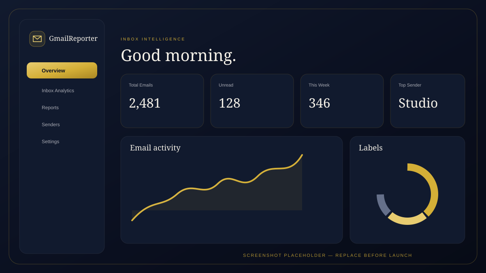

# GmailReporter

GmailReporter adalah web app analitik Gmail dengan antarmuka **luxury SaaS**: Deep Navy, aksen emas, ivory, glassmorphism, serta tipografi Playfair Display dan Inter.

> **Status:** starter production-oriented. Sebelum membuka akses publik, selesaikan checklist pre-launch di bagian akhir, terutama verifikasi OAuth Google dan rate limiter lintas instance.

## Fitur

- Login Google melalui NextAuth.js; akses Gmail bersifat read-only.
- Overview dengan KPI inbox, grafik aktivitas, kategori label, dan email terbaru.
- Inbox analytics dengan query Gmail, filter, pagination, detail pesan, top senders, dan heatmap waktu.
- Pembuatan laporan PDF, CSV, dan JSON beserta preview dan riwayat lokal.
- Dashboard responsif dengan sidebar, tema gelap/terang, toast, transisi, skeleton, dan empty state.
- Metadata SEO, Open Graph image, dan favicon khusus.

## Tech stack

- Next.js 14 App Router + TypeScript
- Tailwind CSS dan komponen bergaya shadcn/ui
- NextAuth.js Google Provider
- TanStack Query, Recharts, Framer Motion
- jsPDF, jsPDF-AutoTable, PapaParse, Sonner

## Persyaratan

- Node.js 20 LTS (minimal Next.js 14: Node.js 18.17)
- npm
- Project Google Cloud dengan Gmail API aktif
- Domain HTTPS untuk deployment production

## Menjalankan lokal

```powershell
npm install
Copy-Item .env.example .env.local
```

Isi variabel di `.env.local`:

```dotenv
GOOGLE_CLIENT_ID=your-google-oauth-client-id
GOOGLE_CLIENT_SECRET=your-google-oauth-client-secret
NEXTAUTH_SECRET=your-long-random-secret
NEXTAUTH_URL=http://localhost:3000
```

Buat secret:

```powershell
node -e "console.log(require('crypto').randomBytes(32).toString('base64'))"
```

Jalankan app:

```powershell
npm run dev
```

Buka [http://localhost:3000](http://localhost:3000). Redirect URI OAuth lokal harus `http://localhost:3000/api/auth/callback/google`.

Validasi sebelum deploy:

```powershell
npm run lint
npm run typecheck
npm run build
```

## Google Cloud OAuth untuk production

1. Pilih atau buat project di [Google Cloud Console](https://console.cloud.google.com/).
2. Pada **APIs & Services → Library**, aktifkan **Gmail API**.
3. Isi **Google Auth Platform / OAuth consent screen**:
   - Atur nama aplikasi, email support, dan kontak developer.
   - Pilih audience yang tepat. Tambahkan test users saat masih dalam mode Testing.
   - Daftarkan domain production dan tautan privacy policy/terms bila diminta.
4. Tambahkan scope `https://www.googleapis.com/auth/gmail.readonly`, `openid`, `https://www.googleapis.com/auth/userinfo.email`, dan `https://www.googleapis.com/auth/userinfo.profile`.
5. Untuk Gmail scope, selesaikan proses verifikasi OAuth yang diminta Google sebelum membuka akses publik. Scope Gmail dapat mensyaratkan verifikasi tambahan/security assessment sesuai cara aplikasi memproses data.
6. Pada **Credentials → Create credentials → OAuth client ID**, pilih **Web application**.
7. Tambahkan:
   - **Authorized JavaScript origin:** `https://your-domain.example`
   - **Authorized redirect URI:** `https://your-domain.example/api/auth/callback/google`
8. Simpan Client ID dan Client Secret di Vercel Environment Variables, bukan di repository.
9. Setelah consent screen dipublikasikan, lakukan login dengan akun production dan periksa bahwa akses Gmail read-only bekerja.

Refresh token disimpan di JWT server-side dan access token diperbarui ketika mendekati kedaluwarsa. Jangan mengekspos token OAuth melalui props, API response, log, atau client-side storage.

## Deploy ke Vercel

1. Push repository ke GitHub/GitLab/Bitbucket dan import project di [Vercel](https://vercel.com/new).
2. Framework preset: **Next.js**. Build command dan output directory gunakan default Next.js.
3. Tambahkan environment variables pada **Project → Settings → Environment Variables** untuk Production (dan Preview bila diperlukan):
   - `GOOGLE_CLIENT_ID`
   - `GOOGLE_CLIENT_SECRET`
   - `NEXTAUTH_SECRET` — secret acak kuat yang sama untuk seluruh instances/environment terkait.
   - `NEXTAUTH_URL` — URL HTTPS canonical production, misalnya `https://gmailreporter.example`.
4. Deploy pertama dan tetapkan custom domain di **Settings → Domains**.
5. Pastikan DNS dan HTTPS aktif. Nilai `NEXTAUTH_URL` harus cocok dengan domain canonical yang digunakan.
6. Kembali ke Google Cloud Console, tambahkan origin dan redirect URI production di atas. Simpan perubahan OAuth.
7. Redeploy agar environment variables dan konfigurasi OAuth aktif.
8. Uji login/logout, `/dashboard`, Gmail API, generate report untuk PDF/CSV/JSON, OG image di `/opengraph-image`, serta tampilan mobile.
9. Konfigurasikan URL Preview Vercel terpisah di Google OAuth hanya jika preview login memang dibutuhkan; batasi ke tim/test users.

## Environment variables

| Variable | Wajib | Keterangan |
|---|---:|---|
| `GOOGLE_CLIENT_ID` | Ya | OAuth Web Client ID dari Google Cloud |
| `GOOGLE_CLIENT_SECRET` | Ya | OAuth Web Client Secret; jangan commit |
| `NEXTAUTH_SECRET` | Ya | Kunci enkripsi/signing JWT NextAuth |
| `NEXTAUTH_URL` | Ya | Base URL app, HTTPS di production |

Salin [`.env.example`](./.env.example) untuk referensi. File `.env.local` dikecualikan Git.

## API utama

Semua endpoint Gmail memerlukan sesi Google yang valid.

| Method | Path | Keterangan |
|---|---|---|
| `GET` | `/api/gmail/messages?query=...&maxResults=...&pageToken=...` | Cari dan paginasi email |
| `GET` | `/api/gmail/messages/:id` | Metadata dan isi pesan |
| `GET` | `/api/gmail/profile` | Email akun dan jumlah pesan |
| `GET` | `/api/gmail/labels` | Daftar label |
| `POST` | `/api/reports/generate` | Agregasi report dan file download |

Rate limit sekarang memakai in-memory store per proses: pesan/detail `60 req/menit`, profile/labels `30 req/menit`, report `5 req/5 menit` per IP dan route. **In-memory limiter tidak dibagi antar serverless instances dan dapat reset saat cold start.** Untuk traffic production multi-instance, migrasikan helper `lib/rate-limit.ts` ke shared store seperti Upstash Redis sebelum mengandalkan limit ini sebagai proteksi kuota/abuse utama.

## Data dan privasi

- Gmail scope yang diminta hanya read-only; endpoint tidak mengubah, mengirim, atau menghapus email.
- Riwayat laporan disimpan di localStorage browser dan tidak tersinkron antar perangkat.
- Report mengandung agregat statistik/pengirim; pertimbangkan sensitivitas data sebelum membagikan file.
- Report dibatasi hingga 1.000 pesan per generate dan UI menandai hasil terpotong.
- Hapus riwayat browser saat menggunakan perangkat bersama, dan cabut akses aplikasi dari Google Account bila tidak digunakan.

## Screenshot

Ganti placeholder berikut dengan screenshot production sebelum rilis publik:



## Checklist pre-launch

- [ ] Isi environment variables production di Vercel; secret tidak ada di repository atau log.
- [ ] `NEXTAUTH_URL` menggunakan domain HTTPS canonical.
- [ ] Google OAuth redirect URI dan JavaScript origin cocok dengan domain production.
- [ ] Gmail API aktif; consent screen, privacy policy, scope verification, dan test-user/publishing status sudah sesuai.
- [ ] Uji login, logout, token refresh setelah expiry, akses Gmail yang dicabut, dan respons 401.
- [ ] Uji pencarian/filter/pagination inbox dan detail email pada data real.
- [ ] Uji laporan PDF, CSV, JSON, tanggal batas, label, dan kasus lebih dari 1.000 pesan.
- [ ] Ganti screenshot placeholder dan lengkapi halaman privacy policy/terms/contact.
- [ ] Ganti in-memory rate limiter dengan shared Upstash Redis untuk production multi-instance.
- [ ] Audit dependency dan selesaikan temuan `npm audit` yang relevan sebelum publikasi.
- [ ] Uji mobile, keyboard navigation, reduced motion, tema terang/gelap, dan browser utama.
- [ ] Aktifkan monitoring error, alerting, backup/retention policy, dan proses incident response.
- [ ] Cabut akses OAuth dan hapus data/log sesuai kebijakan privasi yang dipublikasikan.
